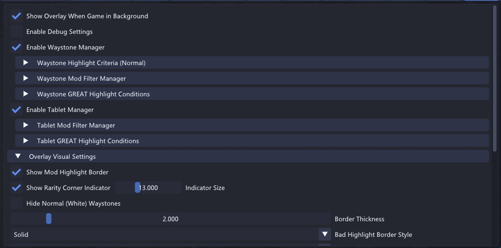
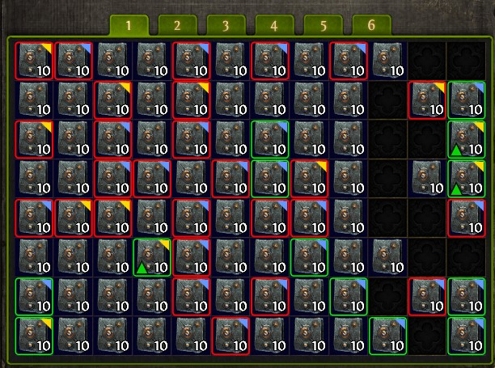
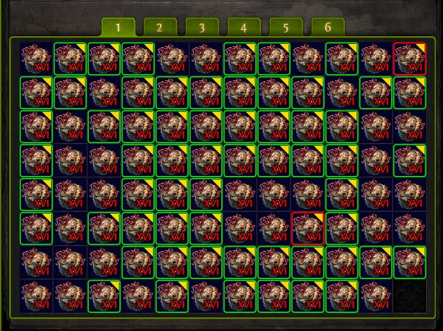

# StashUtility

StashUtility is a plugin for **GameHelper2** designed to manage, filter, and highlight Waystones and Precursor/Breach Tablets for Path of Exile 2. It scans active stash tabs and your character's inventory, applying configurable criteria and mod matching to help you quickly identify run-ready items and avoid undesirable modifiers.





---

## Features

- **Equipment Explicit Affix Tiers**: An optional filter in the existing settings
  highlights magic/rare equipment if any mapped explicit affix is T1 through the
  configured maximum tier. It uses the existing good border style and color.
  The hovered-item inspector displays mapped mod levels and tiers. Missing data,
  bases, and Mod IDs remain Unknown and never trigger this filter.

- **Waystone & Tablet Integration**: Automatically detects, parses, and highlights qualifying Waystones and Tablets inside active stash tabs (standard/quad/waystone layouts) and your character's inventory.
- **Granular Waystone Filter Criteria**:
  - **Min Tier**: Only highlight waystones equal to or above a specified tier (T1–T16).
  - **Filter Revives**: Limit highlights to waystones with at most $N$ max revives (e.g., filter out 0-revive maps).
  - **Item Rarity (%)**: Enforce a minimum item rarity percentage.
  - **Pack Size (%)**: Enforce a minimum monster pack size percentage.
  - **Monster Rarity (%)**: Filter by minimum rare monster count/rarity percentage.
  - **Monster Effectiveness (%)**: Filter by minimum monster effectiveness percentage.
  - **Waystone Drop Chance (%)**: Enforce a minimum waystone drop chance (includes quality calculations).
- **Tablet Mod Filter Manager**:
  - Full support for precursor and breach tablets.
  - Filters are categorized by mechanic type (Breach, Expedition, Delirium, Abyss, Incursion, Ritual, General).
  - Mark individual mods as **Good**, **Bad**, or **God** tier from the UI.
- **GREAT Highlight Conditions**:
  - Set specific thresholds for "GREAT" waystones (rarity, pack size, drop chance, etc.).
  - Set minimum good mods required for a tablet to be highlighted as Great.
  - Configure a minimum number of good mods to ignore bad mods (`MinGoodModsToIgnoreBad`).
- **Compile-Time Mod Database**:
  - Completely refactored to compile the mod definitions in C# (`Data/ModDatabase`).
  - No runtime JSON files required, minimizing dependencies.
- **Highly Customizable Visuals**:
  - Set custom border thickness and style (**Solid**, **Dashed**, or **Dotted**) for good vs. bad highlights.
  - Draw optional triangle corner indicators representing item rarity (Normal, Magic, Rare, Unique).
  - Draw a distinct, configurable **GREAT Arrow** (custom color, size, and position: Top-Left, Top-Right, Bottom-Left, Bottom-Right) on items that meet the Great thresholds.
  - Hides Normal (white) waystones completely if desired.
- **Developer Debug Tools**:
  - **UI Path Explorer**: Interactively click through indices in the game's UI hierarchy, highlight the active node or all child boundaries in-game, and resolve container offsets.
  - **Hovered Item Inspector**: Inspect the entity structure, raw game memory mods, components, and calculated stats of the hovered item.
  - **Memory Dumpers**: Write the resolved UI tree or full entity memory blocks directly to dump files.

---

## Installation

1. Download the latest release `StashUtility.zip` from the GitHub Releases page.
2. Extract the contents into the `Plugins` directory of your GameHelper2 directory:
   ```text
   GameHelper/
   └── Plugins/
       └── StashUtility/
           └── StashUtility.dll
   ```
3. Restart GameHelper2. The plugin will be recognized and loaded automatically.

---

## How to Use

1. **Enable Managers**: Open the GameHelper menu, locate the `StashUtility` section, and check **Enable Waystone Manager** and/or **Enable Tablet Manager**.
2. **Configure Thresholds**: Under **Filter Criteria** or **GREAT Highlight Conditions**, toggle and adjust sliders for minimum tiers, pack size, rarity, and drop chances.
3. **Set Up Mod Matching**:
   - **Waystones**: Search and add mods using the mod database dropdown, flagging them as Good or Bad.
   - **Tablets**: Navigate to the corresponding mechanics tab and check the appropriate Good/Bad/God options for the mods you want to target.
4. **Tune Visuals**: Choose highlight styles (Solid/Dashed/Dotted), select colors for good/bad/great states, and adjust border thickness.
5. **Calibrate UI Path (If Needed)**:
   - If the overlay borders do not align correctly with your stash slots, check the **UI Path Offsets** under debug settings.
   - By default, the path is set to `2,0,0,0,1,1,45,0,1`. You can customize the path indices to match UI changes.

---

### Generating equipment affix tiers

The bundled snapshot was extracted from the official PoE2 patch CDN version
`0.5.5.4.2` on 2026-10-22. It covers 1,836 equipment bases and 2,586 eligible mod
levels in 70 deduplicated affix pools (about 0.5 MB). Input hashes, source details
and validation results are in `Data/equipment_affix_tiers.provenance.json`.
The plugin does not verify the attached client's version: use matching game data.

To refresh, use `pathofexile-dat@16.0.1` in a separate working directory and the
included `affix_tables.config.json` (update its patch version first). It downloads
the required tables directly from the official patch server; no local game
installation is needed. For example, from a scratch extraction directory:

```powershell
npm install --no-save --ignore-scripts pathofexile-dat@16.0.1
# Copy StashUtility/affix_tables.config.json here as config.json first.
node ./node_modules/pathofexile-dat/dist/cli/run.js
```

This produces `tables/English/Mods.json`, `ModType.json`, `Tags.json`,
`BaseItemTypes.json`, `ItemClasses.json` and `ModFamily.json`. Preserve table row
order and indices. The last table is retained for comparison with family-based
rankings; the selected toolkit algorithm groups by ModType.

From `Plugins/StashUtility`, run (replace the version and input directory):

```powershell
python -B generate_affix_tiers.py --tables C:/poe2-tables/English --source-version YOUR_GAME_DATA_VERSION --source-url YOUR_PATCH_CDN_URL --out Data/equipment_affix_tiers.json
```

If you already have poe2-toolkit's keyed `mods.json`, pass `--mods C:/exports/mods.json`.
Then only `Tags.json`, `BaseItemTypes.json` and `ItemClasses.json` are needed in
`--tables`. Toolkit's item export is keyed by localized display names, so it is
not used for runtime identity: the generator retains exact `BaseItemTypes.Id`.

The offline generator references [poe2-toolkit/buildMods.ts](https://github.com/rajtik76/poe2-toolkit/blob/main/packages/poe2-mod-extractor/src/buildMods.ts)
and its [item tag contract](https://github.com/rajtik76/poe2-toolkit/blob/main/packages/poe2-item-extractor/src/buildItems.ts).
It keeps `Domain=Item`, prefix/suffix and `ModType` separation and FIRST matching
spawn tag semantics (zero blocks). It deliberately ignores upstream `tier` and
Mod ID numeric suffixes: distinct levels are ranked descending, T1 best, AFTER
filtering for a base's effective tags. Base drop level does not truncate the
ladder. Identical ranked pools share a lookup profile. This is a derived toolkit
ranking, not a claim that every exceptional mod matches the game's display or
PoE2DB's family-based grouping. Validate representative items when updating data.

For the bundled snapshot, all 125 normal affix entries for Bound Sandals
(`Metadata/Items/Armours/Boots/FourBootsInt2Endgame`) match PoE2DB's intelligence
boots pool by generation type, first family and level, and all 125 computed tiers
agree. The screenshot's four IDs yield: IncreasedLife8 L54/T2, Intelligence6
L55/T3, FireResist5 L48/T4, IncreasedMana5 L33/T5. At maximum T3, the first two
match. This is an offline comparison, not a live-client test.

Other pools contain different ModTypes sharing an exclusion family (e.g. life
and mana flask recovery or different spell-gem levels). Merging them by family
can give different tiers. This feature retains the selected toolkit ModType
classification; the bundled provenance records that limitation.

Build the whole `GameOverlay.sln`; the generated JSON is staged beside the plugin.
Alternatively put it in the running plugin's `Data` directory and use **Reload
Affix Tier Data**. The UI shows its declared source version; it does not detect
the attached client's data version. Regenerate when the game tables change.
The filter defaults to off. Without a generated dataset it reports data not ready.

Offline regressions: `python -m unittest test_affix_tiers.py`.

## Building from Source

To compile the plugin yourself:

1. Place the `StashUtility` repository folder inside the `Plugins/` directory of the `GameHelper2` project.
2. Open the solution `GameOverlay.sln` in Visual Studio.
3. Select the `Release` build configuration and rebuild the solution.
4. The output will automatically copy `StashUtility.dll` and its assets to `GameHelper\bin\Release\net10.0-windows\win-x64\Plugins\StashUtility`.

---

## Release Workflow (GitHub CI/CD)

The repository uses GitHub Actions to automate releases. When you push a new tag matching `v*` (e.g., `v1.1.0`), the workflow:
1. Clones the parent `GameHelper2` repository.
2. Restores and builds the `StashUtility` plugin in Release mode using .NET 10.
3. Gathers the compiled `.dll` and `.pdb`.
4. Packages them into `StashUtility.zip` and uploads them to a newly created GitHub Release.

